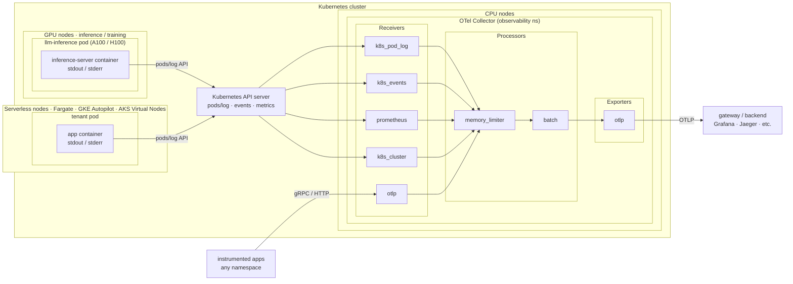

# Architecture

## Goal

Observability for Kubernetes platforms, collected through the API server rather
than the node filesystem. Deployable via Helm in two modes: cluster-wide, or
scoped to a set of namespaces with tenant isolation expressed as RBAC. Neither
mode requires node-level privilege, so the same deployment runs unchanged on
standard, GPU, and serverless nodes.

---

## Collector architecture

The collector runs as a standard Kubernetes **Deployment** (one or more replicas)
on ordinary CPU nodes. It never requires a DaemonSet or node-level filesystem
access.



### Signal pipeline

| Signal | Receiver | What it captures |
|---|---|---|
| **Container logs** | `k8s_pod_log` (custom) | stdout/stderr of every matching container, streamed via `CoreV1().Pods().GetLogs()` — same API path as `kubectl logs -f` |
| **Kubernetes events** | `k8sevents` (contrib) | Pod restarts, OOMKills, scheduling failures, quota violations, image pull errors |
| **App metrics** | `prometheus` (contrib) | Pods annotated with `prometheus.io/scrape: "true"` |
| **Cluster metrics** | `k8s_cluster` (contrib) | Pod/deployment/job resource usage and status via the k8s API — issues a paginated LIST of all watched resource types on start, then switches to a persistent watch with an in-memory cache (30s emit interval makes zero API calls at steady state). Spike is transient but repeats on collector restart or watch reconnect after the API server's watch cache window expires. |
| **Traces** | `otlp` (core) | Spans over gRPC (4317) / HTTP (4318) from instrumented applications |

For the API-collected signals (logs, events, cluster metrics), the receivers set
Kubernetes identity themselves. `k8s_pod_log` stamps six attributes on the
Resource from the pod object it reads — `k8s.namespace.name`, `k8s.pod.name`,
`k8s.pod.uid`, `k8s.container.name`, `k8s.node.name`, and
`k8s.container.restart_count` (an integer) — taking every key from the OTel
semantic conventions rather than a string literal, and setting the matching
`SchemaUrl` on the ResourceLogs so a downstream schema processor can translate
the batch. `k8s_cluster` likewise attaches its k8s attributes to the Resource.
`k8s_events` splits them: object identity (`k8s.object.*`, `k8s.node.name`)
goes on the Resource, but the namespace and event details
(`k8s.namespace.name`, `k8s.event.*`) are set as log-record attributes, not
Resource attributes. No enrichment processor runs on any pipeline — every signal
keeps whatever attributes its receiver (or, for traces, the emitting
application's OTel SDK) set. Traces therefore carry only the Kubernetes context the
application's own resource detector provides; collector-side span enrichment is
deferred (it would be a `k8sattributes` processor on the traces pipeline).

Each log record carries two timestamps: `Timestamp` is the line's own time as
reported by the container runtime (falling back to receipt time if the runtime
gave none), and `ObservedTimestamp` is when the collector read it. The gap
between them is the collection lag for that line, per record.

The collector also exposes its own Go runtime metrics (heap, pipeline throughput,
drop counts) at port 8888 via `service.telemetry`. When `signals.metrics` is
enabled and `scrapeAnnotated: true`, the collector pod carries
`prometheus.io/scrape: "true"` and scrapes itself automatically.

---

## Deployment modes

The Helm chart supports two modes, selected with `mode: namespace|cluster`.

### Namespace mode (default — tenant self-install)

```
Tenant namespace (e.g. payments)
┌────────────────────────────────────────────────────┐
│  Role: pods/get/list/watch                          │
│        pods/log/get                                 │
│        events/get/list/watch                        │
│        apps/*, batch/*, autoscaling/*               │
│                                                     │
│  RoleBinding → ServiceAccount → Collector Pod       │
└────────────────────────────────────────────────────┘
```

- One `Role` + `RoleBinding` per target namespace, created by the chart
- Tenant installs with namespace-admin rights only — no cluster-admin required
- Collector sees only what RBAC allows; other tenants' namespaces are invisible

### Cluster mode (platform admin install)

```
ClusterRole (cluster-wide)
┌────────────────────────────────────────────────────┐
│  All namespace-mode rules                           │
│  + nodes, namespaces, resourcequotas (cluster-wide) │
│  + metrics.k8s.io/pods,nodes                        │
│  + nodes/metrics, nodes/proxy (for kubelet scrape)  │
│                                                     │
│  ClusterRoleBinding → ServiceAccount → Collector    │
└────────────────────────────────────────────────────┘
```

- One `ClusterRole` + `ClusterRoleBinding` for the whole cluster
- Collector watches all namespaces; can optionally scrape node-level metrics
- Requires cluster-admin to install; intended for platform/SRE teams

---

## GPU and AI cluster support

A DaemonSet-based collector schedules a pod on **every node**, including
expensive GPU nodes (A100, H100). The collector pod then competes for CPU
and memory on nodes that should be 100% dedicated to training or inference.

This stack avoids that problem entirely: the collector runs on a **cheap CPU
node** and streams logs from GPU pods through the Kubernetes API. GPU nodes
never host a collector pod. This holds whether the GPU nodes carry a
`nvidia.com/gpu=present:NoSchedule` taint or not — the API-server path is
independent of pod scheduling.

On EKS and GKE the managed control plane absorbs the streaming load without
meaningful overhead. On self-hosted clusters the standard solution is a
kube-apiserver HA setup with a load balancer in front of multiple API server
replicas (the kubeadm HA pattern) — this distributes streaming connections
across replicas and removes the single-instance bottleneck without any changes
to the collector.

---

## Serverless Kubernetes (Fargate, AKS Virtual Nodes, GKE Autopilot)

DaemonSet-based log collectors run into a different constraint on each serverless
platform — none of them block collection the same way:

| Platform | Constraint | API-based approach (this stack) | Source |
|---|---|---|---|
| **AWS Fargate** | DaemonSets aren't supported — each pod runs on its own isolated micro-VM with no shared node to schedule a per-node agent on | Runs as a Deployment, reads via the API server — no per-node agent to schedule | [AWS EKS docs — Fargate](https://docs.aws.amazon.com/eks/latest/userguide/fargate.html) |
| **AKS Virtual Nodes** | DaemonSets won't deploy pods to virtual nodes — ACI-backed nodes accept only standalone Pods | Same Deployment reaches pods on virtual nodes without needing a node-resident collector | [Microsoft Learn — Virtual nodes](https://learn.microsoft.com/en-us/azure/aks/virtual-nodes) |
| **GKE Autopilot** | `hostPath` volumes are read-only and restricted to the `/var/log` prefix — no write access, no other paths. Custom DaemonSets are schedulable, but must meet Autopilot's minimum per-Pod resource requests, and Autopilot applies taints to specialized node types (GPU, spot, and others) — reaching those nodes at all requires adding a blanket toleration (`operator: Exists`) to the DaemonSet spec | No host mount, no DaemonSet, no tolerations to maintain — the collector doesn't need to be scheduled onto every node type in the first place | [GKE Autopilot security](https://docs.cloud.google.com/kubernetes-engine/docs/concepts/autopilot-security), [Resource requests in Autopilot](https://docs.cloud.google.com/kubernetes-engine/docs/concepts/autopilot-resource-requests), [Deploy GPU workloads in Autopilot](https://docs.cloud.google.com/kubernetes-engine/docs/how-to/autopilot-gpus) |

This stack has no such constraint. The collector runs as a standard **Deployment**
in any schedulable node pool, and reads logs through the Kubernetes API — the same
endpoint available regardless of whether tenant workloads run on Fargate, virtual
nodes, or standard nodes.

GKE Autopilot's read-only `/var/log` exception doesn't close the gap: it grants
node-wide read access to every pod's logs on that node, which is exactly the broad,
un-scoped host access this project is designed to avoid — not a substitute for
RBAC-scoped, per-tenant collection through the API server.

Mixed-mode clusters (part serverless, part standard nodes) are the most common
case where this matters: run the collector on a standard node and collect from pods
on serverless nodes with no extra configuration. The API-server path is independent
of where the source pods are scheduled.

---

## Scope

Scoped to **tenant application observability** — signals a service team owns
from their own pods:

| In scope | Mechanism |
|---|---|
| Container stdout/stderr | `k8spodlogreceiver` via `pods/log` RBAC |
| Kubernetes events | `k8seventsreceiver`, namespace-scoped |
| Application Prometheus metrics | Prometheus receiver, annotation-driven |
| Application traces | OTLP receiver, gRPC + HTTP |
| Cluster resource metrics | `k8sclusterreceiver` via k8s API |

### What it intentionally does not cover

| Out of scope | Why |
|---|---|
| Node logs (systemd journal, kubelet, containerd) | Requires `hostPath` — exactly the node-level trust this stack avoids |
| Host-level metrics (disk I/O, network interfaces, OS-layer CPU) | Node exporters need host namespace access |
| Control plane logs (kube-apiserver, etcd, scheduler) | Cluster operator concern, not tenant concern |
| Container runtime / image pull logs | Below the pod API boundary |

Node-level telemetry belongs in a separate cluster-operator-managed pipeline,
kept strictly separate from per-tenant data.

---

## Design principles

1. **No node-level trust by default.** All collection uses the Kubernetes API
   (`pods/log`, events, metrics endpoints). A compromised collector cannot
   read arbitrary host files or escape its RBAC boundary.

2. **Tenant isolation is an RBAC boundary, not a convention.** The Helm chart
   generates a `Role` + `RoleBinding` per namespace in namespace mode, granting
   only the permissions required by the enabled signals. Other tenants' data is
   structurally inaccessible, not just conventionally separated.

3. **Zero footprint on specialized nodes.** The collector never schedules onto
   GPU, high-memory, or otherwise tainted nodes. In AI/ML clusters, inference
   and training nodes remain 100% dedicated to workloads — no DaemonSet pod
   competing for resources on a node that costs orders of magnitude more than
   a standard worker.

4. **Control mapping is explicit, not implied.** See
   [`compliance/`](compliance/) for how the stack's controls map to SOC 2 Trust
   Services Criteria and to CISA's Logging Reference Architecture — including,
   in both, where the mapping stops.

5. **Reproducible builds.** The OCB manifest (`builder-config.yaml`)
   pins every component — including `k8spodlogreceiver`, consumed as a tagged
   module from [the repository](https://github.com/eugenekurasov/k8spodlogreceiver).
   The exact collector binary is reproducible from that manifest via the
   `Dockerfile`.

---

## Current constraints

Properties of the deployed system as it stands, rather than a plan. Most come
from `k8spodlogreceiver`, which lives in
[its own repository](https://github.com/eugenekurasov/k8spodlogreceiver) — see
its [known limitations](https://github.com/eugenekurasov/k8spodlogreceiver#known-limitations)
for the full set and the reasoning behind each.

- **One collector replica per scope.** Stream ownership is tracked in-process,
  so two replicas discover the same pods and emit every record twice. The
  intended way to scale is partitioning — one release per tenant or namespace
  group — not replication. Cross-replica ownership (a consistent-hash ring on
  pod UID plus lease coordination) would be needed for HA within a single scope.
- **Raw lines, one OTel log record per line.** No multiline joining, no
  structured parsing. Both belong downstream, or in a stanza-style operator
  pipeline layered on the receiver later.
- **stdout and stderr are merged** with no per-line marker, so no
  `log.iostream` attribute is set. The `pods/log` endpoint does not expose the
  distinction, even though the runtime records it on disk.
- **In-cluster auth only** in the chart (`api_config.auth_type: serviceAccount`);
  the receiver also supports a kubeconfig path for local development.
- **Every collector restart leaves a permanent gap in Kubernetes Events.**
  This one comes from the upstream `k8s_events` receiver, not
  `k8spodlogreceiver`: it drops any Event timestamped before the receiver
  started, and the API server keeps Events for only `--event-ttl` (one hour by
  default). Its `storage` option prevents duplicates on resume, not the gap.
- **Read cursors are only as durable as their volume.** The chart checkpoints
  them to `file_storage` (`signals.logs.cursorStorage`). The default `emptyDir`
  survives container restarts (OOMKill, liveness failure) but not the pod being
  replaced: a rollout, eviction or drain re-reads from `since_seconds`. Set
  `volume.type: persistentVolumeClaim` to survive those too. The trade is one
  replica and the `Recreate` strategy, because file_storage locks its file.

Planned work on the chart, the collector image, and CI is tracked in the
[README roadmap](../README.md#roadmap).
